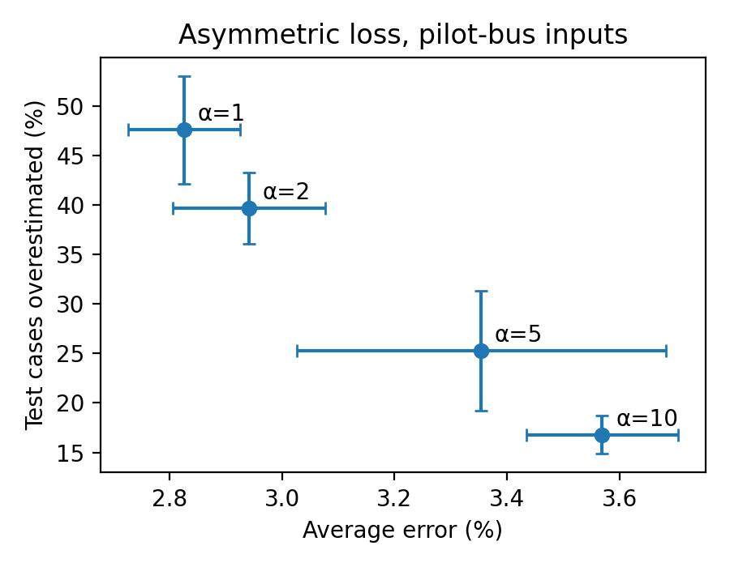
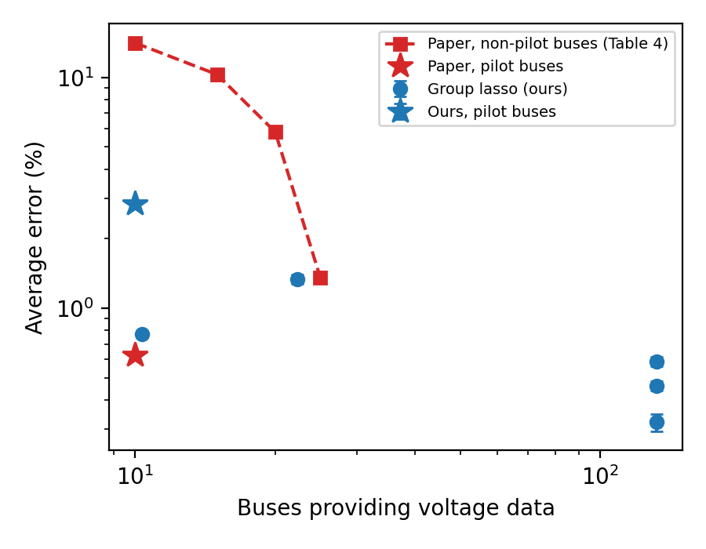

# Real-Time PV Hosting Capacity with Pilot-Bus Neural Networks: Reproduction and Extensions

**Victoria Dinov** · Stanford University · Scientific Machine Learning course project

This repository is an independent PyTorch and OpenDSS reproduction of

> M. N. I. Siddique, K. Prakash, S. Mekhilef, and H. Pota, "Real-time PV hosting capacity analysis of distribution networks using pilot buses data and neural networks," *Applied Energy*, vol. 409, p. 127467, 2026. [doi:10.1016/j.apenergy.2026.127467](https://doi.org/10.1016/j.apenergy.2026.127467)

It also adds two extensions: a loss function that treats overestimation as the costlier error, and a group-lasso penalty that learns which measurements the model needs. The original authors released no code or data, so every component here, from scenario generation and power-flow labeling to training and evaluation, is rebuilt from the paper's text.

---

## Overview

### The problem

**Hosting capacity (HC)** is the largest total PV capacity a distribution feeder can absorb without violating an operating limit, such as a voltage outside its allowed band or a line carrying more current than its rating. Utilities use HC to decide how much new rooftop solar they can approve and where.

The standard way to compute HC is a search:
1. Add PV in small steps.
2. Run an AC power flow after each step.
3. Stop at the first violation.

HC changes with loading and with where PV is installed, so the search must be repeated for every hour and every PV layout. On a realistic feeder this means thousands to millions of power flows, which is too slow for real-time use.

### The paper's idea

Siddique et al. replace the search with a **surrogate model**: a feed-forward neural network trained offline on simulated scenarios, which then predicts HC in microseconds. Its inputs are the **voltage magnitude and angle at about 10 pilot buses**. These buses are selected beforehand so their voltages summarize the state of the whole feeder. Using a few buses keeps the method practical, since a utility only has to meter a handful of locations instead of every bus.

| | |
|---|---|
| **Input** | Voltage magnitude (pu) and angle (degrees) at the pilot-bus phase nodes: 36 features on IEEE 123 |
| **Output** | Feeder-level HC (kW) for that operating condition |
| **Labels** | HC computed by power-flow search in OpenDSS |
| **Model** | MLP, 1 hidden layer of 615 ReLU units, MSE loss |
| **Reported accuracy** | 0.58–0.71% average error on IEEE 123, 0.04 s prediction time |

### What this project contributes

1. **A faithful, open reproduction.** It follows the paper's HC definition, Monte Carlo procedure, network, hyperparameters, test sets, and metrics. Every detail the paper leaves unstated is documented and exposed as a parameter (see [Assumptions](#assumptions-where-the-paper-is-unspecified)).
2. **Asymmetric loss (Modification 1).** Overestimating HC approves PV that will violate a limit, while underestimating only leaves capacity unused. The loss weights overestimates by α ≥ 1, giving a utility one direct control over how often the model errs on the unsafe side.
3. **Bus-level group lasso (Modification 2).** The paper picks pilot buses in a separate multi-objective optimization before training. Here the network sees all 132 buses, and a group-lasso penalty, applied as a proximal step, removes whole buses during training. The number of buses that survive measures how much metering the task actually needs, and is directly comparable to the paper's Table 4.
4. **A diagnosis of where the method works.** The reproduction shows when pilot-bus voltages contain enough information to predict HC and when they do not. It also identifies two features of the paper's setup that make its low error easier to reach (see [Results](#results)).

### Scope

**In scope:**
- The IEEE 123-bus test feeder (OpenDSS), 24 hourly operating points, and PV penetration from 10% to 100%.
- Feeder-level (not per-bus) HC under voltage and line-thermal limits.
- PV at unity power factor and full rated output, as in the paper.

**Out of scope:**
- The paper's second case study, a 732-bus rural feeder in New South Wales, whose model is not public.
- The paper's pilot-bus optimization itself; its selected buses are used instead.
- Robustness to sensor noise (the paper's Tables 5–6).
- Time-series or quasi-static analysis beyond the 24 independent hourly snapshots.

---

## Method

### Hosting capacity

For a scenario *s* with PV units at a set of buses *P*ₛ, every unit has the same size *k*·Δm with Δm = 10 kW. HC is the total PV at the largest step with no violation:

```
HC_s = |P_s| · Δm · max{ k :  0.90 ≤ V_i ≤ 1.10 pu for all nodes i,
                              I_ℓ / I_ℓ,rated < 1 for all lines ℓ }
```

The paper increases *k* one step at a time. This code finds the same *k* by **integer bisection**. It matched the incremental search on every scenario checked and needs about 8 power flows per scenario instead of up to 55. Before every power flow, regulator taps are reset to neutral and re-settled, so each label does not depend on the order of earlier solves.

### Scenario generation (paper Sec. 3.1, Fig. 2)

| Factor | Values |
|---|---|
| PV penetration | 10%, 20%, …, 100% of the 85 load buses (10% = 8 PV units, 100% = 85) |
| PV placements | 100 random site sets per penetration level |
| Hours | 24, with loads scaled by a daily loadshape |
| **Total** | **10 × 100 × 24 = 24,000 scenarios** (HC from 2,160 to 8,840 kW, none with HC = 0) |

For each scenario, the generator stores voltage magnitude and angle at all 278 phase nodes in two states: at the HC point, which gives the model inputs, and with no PV, which is used for an ablation.

### Model and training (paper Sec. 2.5, 3.3, Table 1)

| Setting | Value |
|---|---|
| Inputs | V and θ at the 18 phase nodes of 10 pilot buses (36 features), min-max scaled to [0, 1] |
| Output | HC divided by its training maximum |
| Architecture | 1 hidden layer, 615 ReLU units (5 × 123 buses); 3 layers optional (paper Table 3) |
| Optimizer | Adam, learning rate 10⁻³, batch size 32 |
| Epochs | Up to 1,500, keeping the best validation checkpoint (patience 100) |
| Split | 70/15/15 **by placement**, so all 24 hours of a PV layout stay in one split |
| Test sets | Penetration 10–30% (n = 1,080), 40–60% (n = 1,080), 70–100% (n = 1,440) |
| Metrics | Average and maximum percentage error \|Ĥ − H\| / H × 100, average deviation (kW), RMSE (kW), plus overestimation rate and mean overestimate |

Splitting by placement matters. A random row split would put the same PV layout in both training and test at different hours, which inflates accuracy.

### Modification 1: asymmetric loss

With error *e*ₛ = Ĥₛ − Hₛ:

```
L_α = (1/N) Σ_s w_s · e_s²,      w_s = α if e_s > 0 (overestimate), else 1
```

Setting α = 1 recovers MSE. The same loss is used for validation and early stopping.

### Modification 2: bus-level group lasso

The first-layer weight columns are grouped by bus, so every phase's magnitude and angle at bus *b* form one group *W*_b. This gives 132 groups over 556 inputs. After each Adam step, a proximal step with learning rate η applies

```
W_b ← W_b · max(0, 1 − ηλ / ‖W_b‖₂)
```

This is the exact proximal operator of λ Σ_b ‖W_b‖₂. Unlike adding the penalty to the loss, it drives whole buses exactly to zero, so the set of buses the model uses can be read off directly.

---

## Results

All values are means over 3 seeds on held-out PV placements (`results/summary.csv`).

**Reproduction (10 pilot buses, 1 hidden layer).**

| Test set | Paper avg error | Ours avg error | Ours max error | Ours RMSE (kW) | Predict-the-mean |
|---|---|---|---|---|---|
| 1 (10–30%) | 0.71% | 5.79 ± 0.26% | 34.5% | 347 | 27.46% |
| 2 (40–60%) | 0.59% | 2.43 ± 0.26% | 8.6% | 187 | 11.03% |
| 3 (70–100%) | 0.58% | 0.90 ± 0.08% | 4.9% | 83 | 9.96% |

**Modifications (all 3,600 test scenarios).**

| α | Avg error | Overestimated | | λ | Active buses (range) | Avg error |
|---|---|---|---|---|---|---|
| 1 (MSE) | 2.83% | 47.6% | | 0 | 132 | 0.32% |
| 2 | 2.94% | 39.7% | | 0.03 | 132 | 0.46% |
| 5 | 3.35% | 25.3% | | 0.1 | 132 | 0.59% |
| 10 | 3.57% | 16.8% | | 0.3 | 10 (6–15) | 0.77% |
| | | | | 1 | 22 (10–31) | 1.34% |

 

**Key findings.**

- **High penetration reproduces.** At 70–100%, 10 pilot buses predict HC within 0.90%, close to the paper's 0.58%, in about 3 µs per scenario instead of about 20 ms for the OpenDSS search.
- **The low-penetration gap comes from the pilot buses, not the line ratings.** Removing the thermal limit only lowers Test set 1 error from 5.79% to 5.26%. Using all 132 buses gives 0.32% overall, and 3 hidden layers do not help (6.17%, 2.57%, 0.87%). The placement information is in the voltages, but not at these 10 buses.
- **Asymmetric loss gives a tunable safety margin.** α = 5 nearly halves the overestimation rate (47.6% → 25.3%) for 0.5 points of average error.
- **Group lasso finds better buses than the pilot set.** At λ = 0.3 it keeps 6–15 buses (10 on average) with 0.77 ± 0.02% error, beating the pilot buses in this setup (2.83%) and the paper's 10 non-pilot buses (11.8–15.4%). Every run keeps the same core at the feeder head (150, 150r, 149, 160r, 610) and, at λ = 0.3, none of the paper's pilot buses. These buses see the total power leaving the feeder, which at the HC point is set mostly by the installed PV.
- **Inputs must be measured at the HC point.** With no PV connected, the voltages depend only on the hour (23 distinct vectors in 24,000 rows), and the error is 15.75%, no better than predicting the mean.
- **Labels are coarse at high penetration.** Equal 10 kW steps across 85 units mean each step adds 850 kW, leaving only 3 distinct HC values at 100% penetration.
- **Limitations.** Which buses group lasso keeps beyond the shared core varies by seed: neighboring buses carry nearly the same information, and Adam's normalized steps can revive removed buses. The results cover one feeder, one loadshape, one line-rating rule, and equal-size PV at full output.

The full write-up is in [`report.tex`](report.tex).

---

## Repository structure

```
pv-hosting-capacity-mlp/
├── feeder/                  IEEE 123-bus OpenDSS model (master, lines, loads, regulators, coordinates)
├── data/
│   └── hc_dataset.npz       24,000-scenario dataset (34 MB)
├── src/
│   ├── feeder.py            OpenDSS wrapper: loads, PV placement, limits, bisection HC search
│   ├── generate_data.py     Monte Carlo scenario generation (full or chunked by penetration level)
│   ├── train.py             MLP training and evaluation, both modifications, JSON output
│   ├── sweep.py             Multi-seed experiment grid (--jobs for parallel, --index for Slurm)
│   └── report_numbers.py    Prints every value used in the report
├── scripts/
│   └── sherlock_sweep.sbatch  Slurm job array for running the sweep on Sherlock
├── results/                 Run outputs (JSON + text), summary.csv, fig_alpha.png, fig_lasso.png
├── requirements.txt
├── report.tex           3-page technical report (LaTeX)
└── README.md
```

---

## Usage

### Setup

Python 3.10 or later. The code runs on CPU.

```bash
pip install -r requirements.txt     # opendssdirect.py, numpy, torch, matplotlib
```

Run every command from the repository root.

### Data

`data/hc_dataset.npz` is included. To regenerate it (about 8 minutes):

```bash
python src/generate_data.py --out data/hc_dataset.npz
```

You can also run it in chunks. Each penetration level is seeded separately, so the result is identical:

```bash
python src/generate_data.py --levels 1 2 3 4 5 --out data/parts
python src/generate_data.py --levels 6 7 8 9 10 --out data/parts
python src/generate_data.py --merge data/parts --out data/hc_dataset.npz
```

Voltage-only sensitivity dataset (not included):

```bash
python src/generate_data.py --voltage-only --out data/hc_dataset_vonly.npz
```

| Key | Shape | Contents |
|---|---|---|
| `Vmag`, `Vang` | 24000 × 278 | Node voltage magnitude (pu) and angle (deg) at the HC point (model inputs) |
| `Vmag0`, `Vang0` | 24000 × 278 | Same hour with no PV (ablation) |
| `y` | 24000 | HC label (kW) |
| `pen`, `placement`, `hour` | 24000 | Penetration level, placement index within its level, hour |
| `site_mask` | 24000 × 85 | Which load buses hold PV |
| `node_names`, `pv_sites`, `loadshape` | | Metadata |

### Training

```bash
python src/train.py                                    # reproduction: pilot buses, MSE, 1 × 615
python src/train.py --hidden 615 615 615               # 3 hidden layers (paper Table 3)
python src/train.py --state nopv                       # ablation: inputs measured with no PV
python src/train.py --alpha 5                          # Modification 1: asymmetric loss
python src/train.py --inputs all --lam 0.1             # Modification 2: group lasso over all buses
python src/train.py --data data/hc_dataset_vonly.npz   # voltage-only sensitivity case
```

| Flag | Default | Meaning |
|---|---|---|
| `--inputs` | `pilot` | `pilot` (10 buses) or `all` (132 buses) |
| `--state` | `hc` | Voltages at the HC point (`hc`) or with no PV (`nopv`) |
| `--alpha` | 1.0 | Overestimation weight (1 = MSE) |
| `--lam` | 0.0 | Group-lasso strength λ |
| `--hidden` | 615 | Hidden-layer widths |
| `--lr`, `--batch`, `--epochs`, `--patience` | 1e-3, 32, 1500, 100 | Optimization settings |
| `--seed` | 0 | Controls both weight initialization and the train/val/test split |
| `--json` | none | Write all metrics to a JSON file |

### Experiment sweep

```bash
python src/sweep.py                          # all experiments, seeds 0 1 2 (several CPU-hours)
python src/sweep.py --seeds 0 --only repro   # a quick subset
python src/sweep.py --plot-only              # rebuild summary.csv and figures from saved runs
python src/sweep.py --jobs 4                 # run 4 trainings at once (much faster on a laptop)
python src/report_numbers.py                 # print every value used in the report
```

On a Slurm cluster such as Sherlock, `sbatch --array=0-41 scripts/sherlock_sweep.sbatch` runs every training as its own task.

The sweep covers the reproduction (1 and 3 layers), the no-PV ablation, α ∈ {2, 5, 10}, λ ∈ {0, 0.03, 0.1, 0.3, 1}, the voltage-only case (if that dataset exists), and both modifications combined. Finished runs are skipped, so the sweep can be stopped and resumed.

---

## Assumptions where the paper is unspecified

| Detail | Choice here | Where to change it |
|---|---|---|
| Pilot buses | 17, 25, 31, 38, 45, 54, 61, 74, 84, 95, read from the circles in the paper's Fig. 3 | `PILOT_BUSES` in `src/train.py` |
| Load profile | OpenDSS built-in 24-hour "default" loadshape (0.58–1.00 × nominal) on every load | `Feeder.__init__` |
| Penetration | Percentage of the 85 load buses with a PV unit, rounded. Buses 49, 65, 76 have one load per phase, so their PV is split across phases | `generate_data.py` |
| Line ratings | max(400 A, 1.25 × no-PV current at nominal load). The file's 400 A default is exceeded with no PV in 20 of 24 hours | `Feeder.__init__`; `--voltage-only` drops the limit |
| Input timing | Voltages recorded at the HC point (paper Steps 7–8) | `--state` |
| Hidden units | "5 × total no. of bus" taken as 5 × 123 = 615 | `--hidden` |
| Epochs | Best validation checkpoint with early stopping, instead of a fixed 1,500 | `--patience` |
| Output scaling | HC divided by its training maximum (the paper's "fixed scaling factor") | `src/train.py` |

---

## Citation

If you use this code or dataset, please cite the original paper:

```bibtex
@article{siddique2026realtime,
  title   = {Real-time {PV} hosting capacity analysis of distribution networks using pilot buses data and neural networks},
  author  = {Siddique, Md. Nazrul Islam and Prakash, Krishneel and Mekhilef, Saad and Pota, Hemanshu},
  journal = {Applied Energy},
  volume  = {409},
  pages   = {127467},
  year    = {2026},
  doi     = {10.1016/j.apenergy.2026.127467}
}
```
